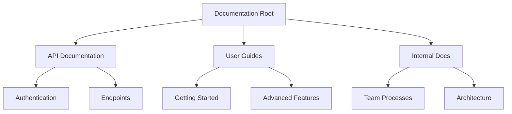

## Folder Structure

A well-organized folder structure is the foundation of effective documentation management. It allows team members to quickly locate information and maintain consistency across projects.

<Columns cols={2}>
  <Card title="Hierarchical Organization" icon="folder" href="#hierarchy">
    Use nested folders to create logical groupings of related documents.
  </Card>
  <Card title="Tagging System" icon="tag" href="#tagging">
    Implement consistent tags for cross-cutting concerns.
  </Card>
</Columns>

## Best Practices

<Steps>
  <Step title="Plan Your Structure" icon="target">
    Before creating documents, outline your folder hierarchy and naming conventions.
  </Step>
  <Step title="Use Consistent Naming" icon="edit">
    Establish clear naming patterns for files and folders.
  </Step>
  <Step title="Implement Tags" icon="hash">
    Apply relevant tags to enable flexible searching and filtering.
  </Step>
  <Step title="Regular Maintenance" icon="refresh-cw">
    Periodically review and reorganize your documentation structure.
  </Step>
</Steps>

## Folder Hierarchy Example



## Tagging Strategies

<Tabs>
  <Tab title="Content Types" icon="file-text">
    Use tags to categorize document types and purposes.
    
    | Tag | Purpose | Example |
    |-----|---------|---------|
    | `tutorial` | Step-by-step guides | Getting Started Tutorial |
    | `reference` | API and technical docs | Authentication API |
    | `faq` | Frequently asked questions | Common Issues FAQ |
    | `troubleshooting` | Problem-solving guides | Error Resolution Guide |
  </Tab>
  <Tab title="Audience" icon="users">
    Tag documents by intended audience for better targeting.
    
    | Tag | Audience | Example |
    |-----|----------|---------|
    | `developer` | Technical team members | API Integration Guide |
    | `admin` | System administrators | Deployment Manual |
    | `user` | End users | User Interface Guide |
    | `stakeholder` | Business stakeholders | Project Overview |
  </Tab>
</Tabs>

## Search and Discovery

<CodeGroup tabs="JavaScript,Python">
  ````javascript
  // Search documents with tags
  const results = await client.documents.search({
    query: 'authentication',
    tags: ['api', 'security'],
    limit: 10
  });
  
  console.log('Found documents:', results.length);
  ````
  ````python
  # Search with filters
  results = client.documents.search(
      query='authentication',
      tags=['api', 'security'],
      limit=10
  )
  
  print(f'Found documents: {len(results)}')
  ````
</CodeGroup>

<Callout kind="tip">Combine tags with search queries for more precise document discovery.</Callout>

## Version Control

<Expandable title="Document Versioning" default-open="false">
  Enable version control to track changes and maintain document history. This ensures you can always reference previous versions and understand the evolution of your documentation.
  
  ```javascript
  const version = await client.documents.createVersion({
    documentId: 'doc-123',
    changes: 'Updated authentication section',
    author: 'talha.iqbal'
  });
  ```
</Expandable>

## Collaboration Features

<ExpandableGroup>
  <Expandable title="Review Workflows" default-open="false">
    Set up approval processes for critical documentation changes to maintain quality and accuracy.
  </Expandable>
  <Expandable title="Comment System" default-open="false">
    Allow team members to add comments and suggestions directly on documents for asynchronous collaboration.
  </Expandable>
  <Expandable title="Access Control" default-open="false">
    Define granular permissions for different team roles and document types.
  </Expandable>
</ExpandableGroup>

## Performance Optimization

| Technique | Benefit | Implementation |
|-----------|---------|----------------|
| Caching | Faster loading | Enable document caching |
| Compression | Reduced bandwidth | Use gzip compression |
| Lazy Loading | Improved UX | Load content on demand |
| CDN | Global distribution | Deploy via content delivery network |

## Monitoring and Analytics

Track how your documentation is being used and accessed to identify areas for improvement.

```javascript
// Get usage statistics
const stats = await client.analytics.getUsage({
  period: '30d',
  metrics: ['views', 'searches', 'downloads']
});

console.log('Documentation usage:', stats);
```

<Callout kind="info">Regular analysis of usage patterns helps optimize your documentation structure and content.</Callout>

## Migration Strategies

When restructuring existing documentation, follow these guidelines to minimize disruption:

1. Plan the migration in phases
2. Update links and references gradually
3. Communicate changes to the team
4. Provide transition guides
5. Monitor for broken links

By implementing these organization strategies, you'll create a documentation system that scales with your team and projects, making information easily accessible and maintainable.